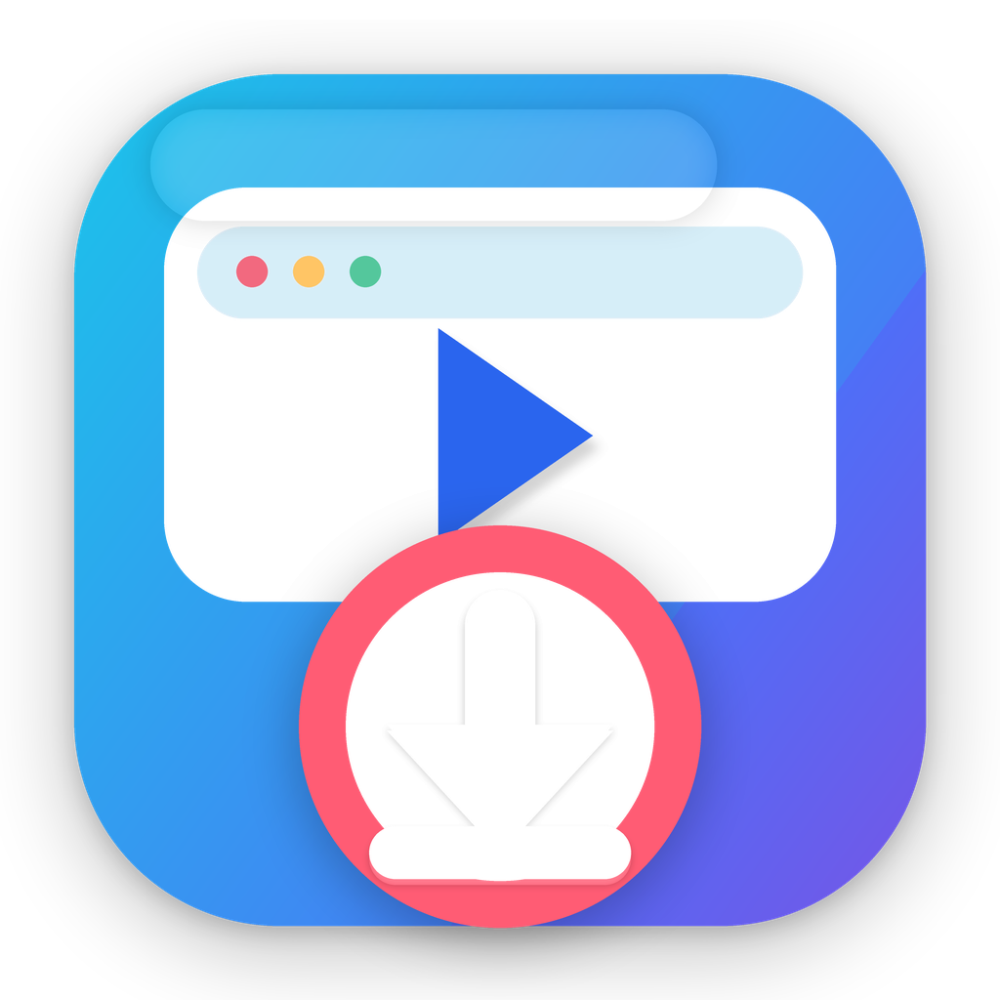

<p align="center">
  
</p>
<h1 align="center">BiliDown</h1>
<p align="center"><strong>A native Bilibili video downloader for macOS</strong><br>Choose video parts, save audio separately, and see download status in one SwiftUI window.</p>
<p align="center">
  
  
  
</p>
<p align="center"><strong>English</strong> · <a href="README.zh-CN.md">简体中文</a></p>
<p align="center">
  <a href="#build-from-source"><strong>Build from source</strong></a> ·
  <a href="#quick-start">Quick start</a> ·
  <a href="https://github.com/ProvenceJake/BiliDown/issues">Report an issue</a>
</p>

---

BiliDown uses [JiJiDownCore](https://client.sabe.cc/installation/macos/) to parse and download videos. When the core cannot start or rejects certain parsing requests, BiliDown can use [yt-dlp](https://github.com/yt-dlp/yt-dlp) instead. The app interface is in Simplified Chinese.

## Features

| Parse videos | Choose what to save | Manage downloads |
| --- | --- | --- |
| Paste a Bilibili URL, a `b23.tv` short link, a BV ID, or an av ID. | Select video parts, choose from the core's available quality options, or save audio only. The yt-dlp fallback uses automatic format selection. | See task status in the app. JiJiDownCore tasks also support pause, resume, and deletion. |

## Build From Source

Requires an Apple Silicon Mac running macOS 15 or later, Swift 6.1 or later, and Homebrew for the commands below.

```sh
brew install ffmpeg yt-dlp
git clone https://github.com/ProvenceJake/BiliDown.git
cd BiliDown
./Scripts/package_app.sh
open build/BiliDown.app
```

The packaging script produces an ad-hoc-signed arm64 app at `build/BiliDown.app`. Run `swift test` to check URL handling.

## Quick Start

1. Paste a Bilibili video link and click **解析链接** (Parse Link). The app starts JiJiDownCore as needed and can install it on first use.
2. Choose a download folder and select the parts to save. To save only audio, turn on **只下载音频** (Audio Only).
3. Click **创建下载任务** (Create Download Task) and follow its status in **任务** (Tasks).

Available formats depend on the video and your Bilibili account. For formats your account can access, use **Cookie 登录** (Cookie Sign-in). Omit cookies and access tokens when filing issues.

Only download videos you have permission to save.
