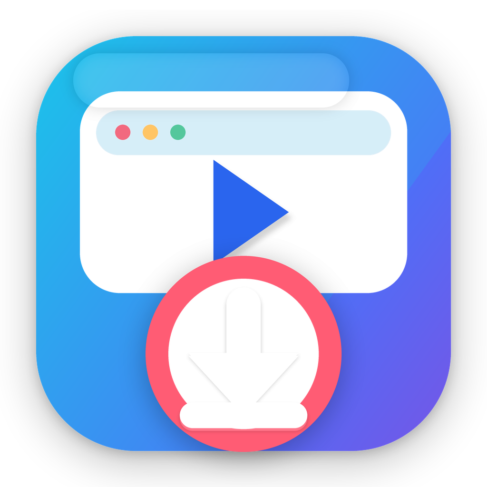

<p align="center">
  
</p>
<h1 align="center">BiliDown</h1>
<p align="center"><strong>原生 macOS 哔哩哔哩视频下载器</strong><br>在一个 SwiftUI 窗口里选择分 P、单独保存音频、查看下载状态。</p>
<p align="center">
  
  
  
</p>
<p align="center"><a href="README.md">English</a> · <strong>简体中文</strong></p>
<p align="center">
  <a href="https://github.com/ProvenceJake/BiliDown/releases/download/v0.1.0/BiliDown-0.1.0-arm64.dmg"><strong>下载 Apple 芯片版</strong></a> ·
  <a href="https://github.com/ProvenceJake/BiliDown/releases">版本说明</a> ·
  <a href="#从源码构建">从源码构建</a> ·
  <a href="#快速使用">快速使用</a> ·
  <a href="https://github.com/ProvenceJake/BiliDown/issues">反馈问题</a>
</p>

---

BiliDown 使用 [JiJiDownCore](https://client.sabe.cc/installation/macos/) 解析和下载视频。核心无法启动或拒绝特定解析请求时，应用可以切换到 [yt-dlp](https://github.com/yt-dlp/yt-dlp)。应用界面为简体中文。

## 功能

| 解析视频 | 选择保存内容 | 管理下载 |
| --- | --- | --- |
| 支持哔哩哔哩链接、`b23.tv` 短链、BV 号和 av 号。 | 支持选择分 P、选择核心提供的清晰度或只下载音频。使用 yt-dlp 时自动选择格式。 | 在应用里查看任务状态。JiJiDownCore 任务还支持暂停、继续和删除。 |

## 安装

1. 下载 [Apple 芯片版 DMG](https://github.com/ProvenceJake/BiliDown/releases/download/v0.1.0/BiliDown-0.1.0-arm64.dmg)，打开后将 **BiliDown.app** 拖到**应用程序**。
2. 使用 Homebrew 安装外部工具。FFmpeg 用于合并音视频，yt-dlp 用于备用解析和下载。

   ```sh
   brew install ffmpeg yt-dlp
   ```

DMG 需要 macOS 15 或更高版本。应用采用 Ad Hoc 签名，未经 Apple 公证。如果 macOS 拦截首次启动，可以参考 [Apple 的打开说明](https://support.apple.com/zh-cn/102445)。SHA-256 校验值见[发布页](https://github.com/ProvenceJake/BiliDown/releases/tag/v0.1.0)。

## 从源码构建

需要搭载 Apple 芯片的 Mac、macOS 15 或更高版本以及 Swift 6.1 或更高版本。以下命令使用 Homebrew 安装依赖。

```sh
brew install ffmpeg yt-dlp
git clone https://github.com/ProvenceJake/BiliDown.git
cd BiliDown
./Scripts/package_app.sh
open build/BiliDown.app
```

打包脚本会在 `build/BiliDown.app` 生成使用 Ad Hoc 签名的 arm64 应用。运行 `swift test` 可检查链接处理逻辑。

## 快速使用

1. 粘贴哔哩哔哩视频链接，点击**解析链接**。应用会按需启动 JiJiDownCore，首次使用时可自动安装核心。
2. 选好下载目录和要保存的分 P。需要单独保存音频时，勾选**只下载音频**。
3. 点击**创建下载任务**，在**任务**区域查看下载状态。

可用格式取决于视频和你的哔哩哔哩账号权限。下载账号有权访问的格式时，可使用**Cookie 登录**。提交问题时请移除 Cookie 和访问令牌。

请仅下载你有权保存的视频。
